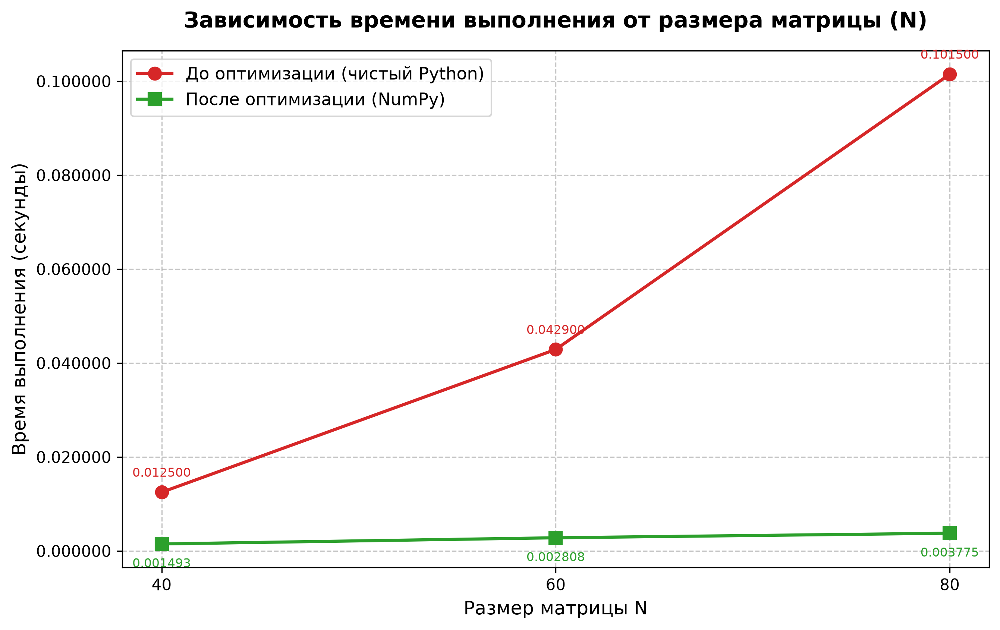

# Практическое занятие 3

## Оптимизация матричных вычислений средствами NumPy

**Дисциплина:** Оптимизация программного кода

**Вариант:** 4


## 1. Цель работы

Ускорить умножение матриц и вычисление статистики строк, сохранив формат возвращаемых данных. 

## 2. Исходная программа и узкие места

`generate_matrix(n)` формирует две квадратные матрицы случайных значений. `matrix_multiply(a, b)` вычисляет произведение тройным циклом Python. `row_stats` отдельно находит минимум, максимум и среднее в каждой строке. `run_task` возвращает среднее первой строки и первый элемент произведения, округлённые до пяти знаков.

Для квадратных матриц умножение требует `O(n³)` арифметических операций; большое число итераций и обращений к элементам списков выполняется интерпретатором Python. Статистика имеет сложность `O(n²)` и обходит каждую строку трижды. Генерация данных также занимает `O(n²)`. Память программы — `O(n²)`.

Исходная функция умножения допускает прямоугольные совместимые матрицы, хотя демонстрационный запуск использует квадратные. Пустые, несовместимые и неоднородные матрицы не входят в область проверенных входных данных.

## 3. Выполненная оптимизация

В оптимизированном файле вложенные списки преобразуются в массивы NumPy, а произведение вычисляется оператором `@`:

```python
return (np.asarray(a) @ np.asarray(b)).tolist()
```

Основной объём работы выполняется скомпилированными численными процедурами. Для обычного плотного умножения общий порядок остаётся `O(n³)`; выигрыш связан с реализацией операций и организацией работы с памятью.

Статистика рассчитывается по оси строк:

```python
arr = np.asarray(matrix)
mins = np.min(arr, axis=1)
maxs = np.max(arr, axis=1)
means = np.mean(arr, axis=1)
```

Результат возвращается как `list[tuple[float, float, float]]`; произведение — как `list[list[float]]`. Явные преобразования `float` сохраняют обычные скалярные типы Python. При этом преобразование списков в массивы, обратный `tolist()` и повторное создание массива в `row_stats` имеют собственную стоимость и выделяют дополнительную память. Векторизация статистики не означает единственный общий проход: `min`, `max` и `mean` остаются отдельными операциями.

## 4. Методика эксперимента

Среда измерений: Python `3.12.14 (main, Aug 25 2026, 14:01:42) [MSC v.1944 64 bit (AMD64)]`, NumPy `2.3.5`, `Windows-11-10.0.26200-SP0`. Процессор: `Intel64 Family 6 Model 186 Stepping 2, GenuineIntel`.

Для каждого размера выполнено 5 запусков каждой версии. Перед каждым запуском устанавливался `random.seed(42)`, выполнялся `gc.collect()`, затем `run_task(n)` измерялась через `time.perf_counter()`. В таблицах приведены медиана и диапазон минимум–максимум. Импорты, установка seed и сборка мусора не включены во время; генерация данных внутри `run_task` включена.

Пик памяти измерялся отдельным запуском через `tracemalloc`, без одновременного измерения времени. Это отслеживаемые выделения памяти, а не RSS процесса; импортированные библиотеки и их исходная память не включены. Фоновая нагрузка Windows не изолировалась. Коэффициенты характеризуют данный запуск и могут изменяться на другом компьютере.

Размеры матриц: 40×40, 60×60 и 80×80. Seed сбрасывался для каждого размера и повторения. В исходном демонстрационном блоке seed задаётся один раз перед циклом размеров; поэтому значения для второго и третьего размеров при непосредственном запуске файлов могут отличаться от таблицы ниже, хотя обе версии по-прежнему получают одинаковые данные между собой.

## 5. Результаты

| N | Python, с | Мин–макс, с | NumPy, с | Мин–макс, с | Ускорение | Пик Python, КиБ | Пик NumPy, КиБ |
|---:|---:|---:|---:|---:|---:|---:|---:|
| 40 | 0.002930 | 0.002210–0.004284 | 0.000374 | 0.000334–0.000704 | 7.84× | 161.59 | 178.32 |
| 60 | 0.008000 | 0.007365–0.010034 | 0.000651 | 0.000560–0.000730 | 12.29× | 360.46 | 392.32 |
| 80 | 0.019263 | 0.019103–0.019487 | 0.001080 | 0.001018–0.001207 | 17.83× | 645.71 | 695.17 |

На размере 80×80 получено ускорение примерно в 17.83 раза. Пик отслеживаемой памяти NumPy-версии немного выше: преобразования форматов создают дополнительные объекты. Следовательно, эта оптимизация ориентирована прежде всего на время.

### График новых измерений

Время в миллисекундах, один `#` приблизительно равен 1 мс. Для значений меньше 1 мс оставлен один символ; точное значение приведено справа.

```text
N=40 Python ### 2.930 мс
N=40 NumPy  # 0.374 мс
N=60 Python ######## 8.000 мс
N=60 NumPy  # 0.651 мс
N=80 Python ################### 19.263 мс
N=80 NumPy  # 1.080 мс
```

### Ранее подготовленный график



Файл `graf_script.py` содержит ранее заданные вручную значения: для Python — 0.0125, 0.0429, 0.1015 с, для NumPy — 0.001493, 0.002808, 0.003775 с. График иллюстрирует эти данные и не строится автоматически из текущего запуска. Условия получения прежних значений в файле не зафиксированы, поэтому их нельзя смешивать с новыми замерами или использовать для оценки разброса времени.

## 6. Проверка корректности

Выполнено 7 проверок: 4 случая сравнения полных матриц и статистик плюс 3 случая `run_task` на измеренных размерах. Все проверки пройдены.

Для полных матриц проверены размеры `(строки A, общий размер, столбцы B)`: `(1,1,1)`, `(2,3,4)`, `(5,5,5)`, `(8,4,6)`. Использованы случайные положительные и отрицательные числа из диапазона `[-5,5]` и фиксированный генератор `random.Random(2026)`. Произведения и статистики сопоставлены через `numpy.testing.assert_allclose(rtol=1e-12, atol=1e-12)`. Максимальная абсолютная разница элементов произведения составила около `3.55e-15`.

| N | Результат исходной версии | Результат NumPy | Совпадение после округления |
|---:|---|---|---|
| 40 | `(9.83711, 9.16174)` | `(9.83711, 9.16174)` | Да |
| 60 | `(13.54678, 13.74224)` | `(13.54678, 13.74224)` | Да |
| 80 | `(19.01434, 18.74777)` | `(19.01434, 18.74777)` | Да |

Сравнивать все промежуточные значения `float` побитово некорректно: порядок накопления произведений может различаться. Проверка с допуском позволяет обнаружить существенную ошибку, учитывая машинное округление. На проверенных данных конечные пары после округления совпали точно; это не доказывает такого совпадения для всех возможных входов.

## 7. Компромиссы и выводы

NumPy целесообразен для плотных численных матриц, когда стоимость вычислений превышает расходы на преобразование данных. Для очень маленьких матриц или единичных дешёвых операций эти расходы могут сократить пользу; граница в данной работе не измерялась.

Дальнейшее улучшение — хранить данные в массивах NumPy от генерации до вычисления статистики, исключив промежуточный `tolist()` и повторный `asarray`. Это изменит внутренний поток данных и потребует повторной проверки интерфейса и воспроизводимости генератора. Для текущей реализации выигрыш времени подтверждён измерениями, а дополнительное потребление памяти следует учитывать отдельно.

## 8. Запуск

Требуются Python 3.9+ и NumPy. Для построения существующего графика дополнительно нужен Matplotlib. Из папки практики:

```powershell
python variant_4.py
python variant_4_optimazed.py
python graf_script.py
```

Пример независимой проверки совместимости прямоугольных матриц:

```python
import variant_4 as original
import variant_4_optimazed as optimized
import numpy as np

a = [[1.0, -2.0, 3.0], [4.0, 5.0, -6.0]]
b = [[2.0, 1.0], [0.0, 3.0], [-1.0, 4.0]]
x = original.matrix_multiply(a, b)
y = optimized.matrix_multiply(a, b)
np.testing.assert_allclose(x, y, rtol=1e-12, atol=1e-12)
np.testing.assert_allclose(original.row_stats(x), optimized.row_stats(y),
                           rtol=1e-12, atol=1e-12)
```

## 9. Исходный и оптимизированный код

### Исходная версия

Файл `variant_4.py`:

```python
import time
import random


def matrix_multiply(a: list[list[float]], b: list[list[float]]) -> list[list[float]]:
    n = len(a)
    m = len(b[0])
    p = len(b)
    result = [[0.0 for _ in range(m)] for _ in range(n)]
    for i in range(n):
        for j in range(m):
            s = 0.0
            for k in range(p):
                s += a[i][k] * b[k][j]
            result[i][j] = s
    return result


def row_stats(matrix: list[list[float]]) -> list[tuple[float, float, float]]:
    stats = []
    for row in matrix:
        mn = row[0]
        for x in row:
            if x < mn:
                mn = x
        mx = row[0]
        for x in row:
            if x > mx:
                mx = x
        total = 0.0
        for x in row:
            total += x
        mean = total / len(row)
        stats.append((mn, mx, mean))
    return stats


def generate_matrix(n: int) -> list[list[float]]:
    return [[random.random() for _ in range(n)] for _ in range(n)]


def run_task(n: int):
    a = generate_matrix(n)
    b = generate_matrix(n)
    product = matrix_multiply(a, b)
    stats = row_stats(product)
    return round(stats[0][2], 5), round(product[0][0], 5)


if __name__ == "__main__":
    random.seed(42)
    for n in [40,  60, 80 ]: 
        start = time.perf_counter()
        res = run_task(n)
        elapsed = time.perf_counter() - start
        print(f"N={n:3d}  result={res}  time={elapsed:.4f}s")

```

### Оптимизированная версия

Файл `variant_4_optimazed.py`:

```python
import time
import random
import numpy as np

def matrix_multiply(a: list[list[float]], b: list[list[float]]) -> list[list[float]]:
    # Векторизованное умножение матриц с помощью NumPy
    return (np.asarray(a) @ np.asarray(b)).tolist()

def row_stats(matrix: list[list[float]]) -> list[tuple[float, float, float]]:
    arr = np.asarray(matrix)
    # Векторизованное вычисление статистики по строкам (axis=1)
    mins = np.min(arr, axis=1)
    maxs = np.max(arr, axis=1)
    means = np.mean(arr, axis=1)
    
    # Сборка результата в формат, идентичный исходному (список кортежей float)
    return [(float(mn), float(mx), float(mean)) for mn, mx, mean in zip(mins, maxs, means)]

def generate_matrix(n: int) -> list[list[float]]:
    return [[random.random() for _ in range(n)] for _ in range(n)]

def run_task(n: int):
    a = generate_matrix(n)
    b = generate_matrix(n)
    product = matrix_multiply(a, b)
    stats = row_stats(product)
    return round(stats[0][2], 5), round(product[0][0], 5)

if __name__ == "__main__":
    random.seed(42)
    for n in [40,  60, 80]:
        start = time.perf_counter()
        res = run_task(n)
        elapsed = time.perf_counter() - start
        print(f"N={n:3d}  result={res}  time={elapsed:.6f}s")
```

## 10. Воспроизведение измерений

Следующий фрагмент запускается из папки практики. Он воспроизводит схему замеров, использованную в таблицах, и печатает исходные значения в секундах и байтах. Импорт NumPy для практики 3 выполняется до начала измерений через оптимизированный модуль.

```python
import gc
import random
import statistics
import time
import tracemalloc
import variant_4 as original
import variant_4_optimazed as optimized

sizes = (40, 60, 80)
for n in sizes:
    for name, module in (("original", original), ("optimized", optimized)):
        samples = []
        for _ in range(5):
            random.seed(42)
            gc.collect()
            start = time.perf_counter()
            result = module.run_task(n)
            samples.append(time.perf_counter() - start)
        random.seed(42)
        gc.collect()
        tracemalloc.start()
        memory_result = module.run_task(n)
        _, peak = tracemalloc.get_traced_memory()
        tracemalloc.stop()
        assert memory_result == result
        print(n, name, result, statistics.median(samples),
              min(samples), max(samples), peak)
```
