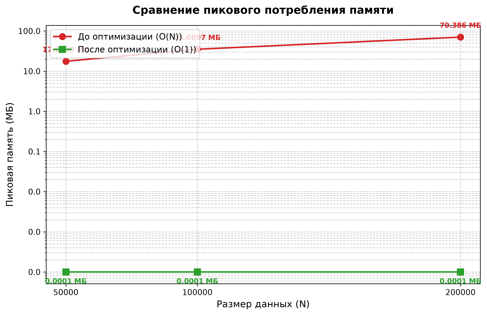

# Практическое занятие 4

## Оптимизация памяти при обработке последовательности записей

**Дисциплина:** Оптимизация программного кода

**Вариант:** 4

**Дата:** 4 ноября 2026 года

## 1. Цель работы

Сократить дополнительную память при вычислении количества и суммы значений, превышающих порог `0.4`. Рассматриваются готовые файлы `variant_4.py` и `variant_4_optimazed.py`. Потоковая обработка устраняет накопление промежуточных коллекций: дополнительная память практически не зависит от числа записей, а время на измеренных размерах уменьшилось примерно в 2.2–2.4 раза.

## 2. Анализ исходной программы

Функция `load_and_process(n)` последовательно:

1. Создаёт `n` строк вида `id,value,code,msg` и сохраняет их в `lines`.
2. Разбирает строки и формирует список словарей `rows`.
3. Создаёт список `filtered` со значениями `value > 0.4`.
4. Возвращает число подходящих записей и сумму их значений.

Одновременно живут строки, списки, словари и разобранные значения. `filtered` хранит ссылки на словари, а не их полные копии, но тоже увеличивает расход памяти. Для итоговых двух агрегатов поля `id`, `code` и `msg` не используются.

Время исходной версии — `O(n)` при принятой модели ограниченного размера записи; дополнительная память — `O(n)`. Формирование строк, разбор, преобразование типов и выделение множества объектов дают значительные постоянные расходы.

## 3. Выполненная оптимизация

В оптимизированной версии остаются только текущие значения, счётчик и накопленная сумма:

```python
filtered_count = 0
total_sum = 0.0
```

Основной цикл:

```python
for i in range(n):
    val = float(f"{random.random():.6f}")
    _ = random.randint(0, 100)
    if val > 0.4:
        filtered_count += 1
        total_sum += val
return filtered_count, total_sum
```

Списки строк и словарей больше не создаются. Время сохраняет порядок `O(n)`, дополнительная память — `O(1)` по числу одновременно хранимых записей. В строгой битовой модели размер счётчика растёт с `log(n)`; практическая оценка `O(1)` относится к обычным машинным диапазонам и отсутствию коллекций размера `n`.

Две детали необходимы для сохранения поведения:

- `float(f"{random.random():.6f}")` воспроизводит округление значения до шести знаков перед проверкой порога. Использование необработанного `random.random()` может изменить выборку.
- Вызов `random.randint(0, 100)` сохранён, хотя его результат не используется. Его удаление изменило бы состояние генератора и все последующие значения `random.random()`.

Оператор сравнения остаётся строгим: значение, равное `0.4` после округления, в результат не включается.

## 4. Методика эксперимента

Среда измерений: Python `3.12.14 (main, Aug 25 2026, 14:01:42) [MSC v.1944 64 bit (AMD64)]`, NumPy `2.3.5`, `Windows-11-10.0.26200-SP0`. Процессор: `Intel64 Family 6 Model 186 Stepping 2, GenuineIntel`.

Для каждого размера выполнено 5 запусков каждой версии. Перед каждым запуском устанавливался `random.seed(42)`, выполнялся `gc.collect()`, затем `run_task(n)` измерялась через `time.perf_counter()`. В таблицах приведены медиана и диапазон минимум–максимум. Импорты, установка seed и сборка мусора не включены во время; генерация данных внутри `run_task` включена.

Пик памяти измерялся отдельным запуском через `tracemalloc`, без одновременного измерения времени. Это отслеживаемые выделения памяти, а не RSS процесса; импортированные библиотеки и их исходная память не включены. Фоновая нагрузка Windows не изолировалась. Коэффициенты характеризуют данный запуск и могут изменяться на другом компьютере.

Размеры: 50 000, 100 000 и 200 000 записей. Обе версии запускались с одинаковым seed. Существующие демонстрационные блоки измеряют время при включённом `tracemalloc`; в новых замерах эти измерения разделены, чтобы трассировка выделений не искажала сравнение времени.

## 5. Результаты

| N | Исходная, с | Мин–макс, с | Потоковая, с | Мин–макс, с | Ускорение | Пик исходной, МиБ | Пик потоковой, байт |
|---:|---:|---:|---:|---:|---:|---:|---:|
| 50,000 | 0.061549 | 0.060192–0.062895 | 0.027881 | 0.027324–0.031204 | 2.21× | 17.6366 | 299 |
| 100,000 | 0.135542 | 0.124215–0.170206 | 0.055549 | 0.054391–0.064696 | 2.44× | 35.1292 | 299 |
| 200,000 | 0.251542 | 0.247436–0.279109 | 0.110612 | 0.108532–0.119560 | 2.27× | 70.4257 | 299 |

Один МиБ равен `1 048 576` байтам. При 200 000 записях пик исходной версии — около 70.43 МиБ, оптимизированной — 299 отслеживаемых байт. Это уменьшение отслеживаемого пика более чем в 200 тысяч раз, но не уменьшение общей памяти процесса в столько же раз: память интерпретатора и библиотек в эту величину не входит.

### График новых измерений памяти

Исходная версия: один `#` приблизительно равен 2 МиБ. Для потоковой версии показано точное значение, поскольку оно слишком мало для общей линейной шкалы.

```text
N= 50000 ######### 17.64 МиБ
N=100000 ################## 35.13 МиБ
N=200000 ################################### 70.43 МиБ
Потоковая, все N: 299 байт
```

### Ранее подготовленный график



В `graf.py` вручную заданы прежние значения пика: 17.6139, 35.0897, 70.3860 для исходной версии и 0.0001 для оптимизированной. На графике единицы подписаны «МБ», хотя код измерителя делит на `1024 * 1024`, то есть использует МиБ. Применена логарифмическая шкала. Эти данные отражают ранее подготовленную иллюстрацию; новые измерения приведены отдельно выше. Округлённое `0.0001` не является нулевым потреблением памяти и не совпадает с новым измеренным пиком 299 байт.

## 6. Проверка корректности

Проведено 15 проверок: 12 комбинаций `seed ∈ {0,42,2026}` и `n ∈ {0,1,10,1000}`, а также 3 измеренных размера. Все проверки пройдены. Количество элементов сравнивалось точно, суммы — через `math.isclose(rel_tol=1e-12, abs_tol=1e-12)`.

На 12 малых комбинациях дополнительно проверено совпадение `random.getstate()` после выполнения: сохранён порядок обращений к генератору. Случай `n=0` проверяет пустую последовательность.

| N | Количество в обеих версиях | Сумма исходной | Сумма потоковой |
|---:|---:|---:|---:|
| 50,000 | 30074 | `21048.538275` | `21048.53827499999` |
| 100,000 | 59859 | `41900.341798` | `41900.34179799989` |
| 200,000 | 119856 | `83888.26643` | `83888.2664299998` |

В текущей среде суммы не совпадают побитово: исходная версия использует встроенную `sum`, оптимизированная — последовательное `+=`. Округление при накоплении `float` даёт небольшую разницу. Максимальная наблюдавшаяся абсолютная разница — около `2.04e-10` на 200 000 записях, относительная — около `2.43e-15`. Результаты согласуются в пределах установленного допуска, но утверждать полное сохранение битового результата нельзя.

Если контракт требует точного равенства исходной `sum` в используемой версии Python, следует передавать подходящие значения в `sum` через генератор, сохранив обе операции генерации случайных чисел. Такой вариант остаётся потоковым, но не входит в уже готовый код и в представленные замеры.

## 7. Компромиссы и выводы

| Критерий | Исходная версия | Оптимизированная версия |
|---|---|---|
| Промежуточные данные | Строки, словари, списки | Текущее значение и два агрегата |
| Дополнительная память | Линейная по N | Без коллекций, растущих с N |
| Время | Линейное, с разбором и выделением объектов | Линейное, меньше промежуточной работы |
| Повторное использование записей | Возможно, пока коллекции доступны внутри функции | Требует повторной генерации или отдельного хранения |
| Точность суммы | Поведение встроенной `sum` | Последовательное накопление, возможна небольшая разница |

Потоковая обработка подходит, поскольку внешний результат состоит только из количества и суммы. Если впоследствии понадобятся сортировка, произвольный доступ или возвращение всех записей, отказ от хранения потребуется пересмотреть. Если входом станут реальные CSV-строки, разбирать их всё равно придётся; останется полезным отказ от накопления всех строк и словарей, но ускорение следует измерить заново.

Главный результат работы — устранение линейного роста дополнительной памяти. Ускорение является сопутствующим эффектом сокращения выделений объектов и преобразований данных. Численная эквивалентность подтверждена с явно заданным допуском.

## 8. Запуск и пример проверки

Для расчётных файлов достаточно стандартной библиотеки Python 3.9+. Для `graf.py` нужен Matplotlib. Из папки практики:

```powershell
python variant_4.py
python variant_4_optimazed.py
python graf.py
```

Пример проверки одинаковых входных последовательностей и результата:

```python
import math
import random
import variant_4 as original
import variant_4_optimazed as optimized

for seed in (0, 42, 2026):
    for n in (0, 1, 10, 1000):
        random.seed(seed)
        expected = original.run_task(n)
        state = random.getstate()
        random.seed(seed)
        actual = optimized.run_task(n)
        assert actual[0] == expected[0]
        assert math.isclose(actual[1], expected[1], rel_tol=1e-12, abs_tol=1e-12)
        assert random.getstate() == state
```

## 9. Исходный и оптимизированный код

### Исходная версия

Файл `variant_4.py`:

```python
"""
Вариант 4.
"""
import random
import tracemalloc
import time
def load_and_process(n: int) -> tuple[int, float]:
    lines = []
    for i in range(n):
        line = f"{i},{random.random():.6f},{random.randint(0,100)},msg_{i%50}"
        lines.append(line)
    rows = []
    for line in lines:
        parts = line.split(",")
        rows.append({
            "id": int(parts[0]),
            "value": float(parts[1]),
            "code": int(parts[2]),
            "msg": parts[3],
        })
    filtered = [r for r in rows if r["value"] > 0.4]
    s = sum(r["value"] for r in filtered)
    return len(filtered), s

def run_task(n: int):
    return load_and_process(n)

if __name__ == "__main__":
    # Те же размеры, что и в оптимизированной версии — для честного сравнения
    n_values = [50_000, 100_000, 200_000]

    # Заголовок таблицы (идентичен оптимизированной версии)
    print(f"{'N':>8} | {'Результат':<35} | {'Память (МБ)':>12} | {'Время (с)':>10}")
    print("-" * 75)

    for n in n_values:
        # Фиксируем seed для идентичных данных с оптимизированной версией
        random.seed(42)

        # Замер памяти через tracemalloc
        tracemalloc.start()
        start = time.perf_counter()

        res = run_task(n)

        # Получаем пиковое потребление памяти
        current, peak = tracemalloc.get_traced_memory()
        tracemalloc.stop()
        elapsed = time.perf_counter() - start

        # Переводим байты в мегабайты
        peak_mb = peak / (1024 * 1024)

        # Вывод в том же формате, что и в оптимизированной версии
        print(f"{n:>8} | {str(res):<35} | {peak_mb:>12.4f} | {elapsed:>10.4f}")

```

### Оптимизированная версия

Файл `variant_4_optimazed.py`:

```python
import random
import time
import tracemalloc
def load_and_process(n: int) -> tuple[int, float]:
    filtered_count = 0
    total_sum = 0.0
    for i in range(n):
        val = float(f"{random.random():.6f}")
        _ = random.randint(0, 100)
        if val > 0.4:
            filtered_count += 1
            total_sum += val
    return filtered_count, total_sum
def run_task(n: int) -> tuple[int, float]:
    return load_and_process(n)
if __name__ == "__main__":
    random.seed(42)
    n_values = [50_000, 100_000, 200_000]
    print(f"{'N':>8} | {'Результат':<35} | {'Память (МБ)':>12} | {'Время (с)':>10}")
    print("-" * 75)
    for n in n_values:
        random.seed(42)  
        tracemalloc.start()
        start = time.perf_counter()
        res = run_task(n)
        current, peak = tracemalloc.get_traced_memory()
        tracemalloc.stop()
        elapsed = time.perf_counter() - start
        peak_mb = peak / (1024 * 1024)
        print(f"{n:>8} | {str(res):<35} | {peak_mb:>12.4f} | {elapsed:>10.4f}")
```

## 10. Воспроизведение измерений

Следующий фрагмент запускается из папки практики. Он воспроизводит схему замеров, использованную в таблицах, и печатает исходные значения в секундах и байтах. Импорт NumPy для практики 3 выполняется до начала измерений через оптимизированный модуль.

```python
import gc
import random
import statistics
import time
import tracemalloc
import variant_4 as original
import variant_4_optimazed as optimized

sizes = (50000, 100000, 200000)
for n in sizes:
    for name, module in (("original", original), ("optimized", optimized)):
        samples = []
        for _ in range(5):
            random.seed(42)
            gc.collect()
            start = time.perf_counter()
            result = module.run_task(n)
            samples.append(time.perf_counter() - start)
        random.seed(42)
        gc.collect()
        tracemalloc.start()
        memory_result = module.run_task(n)
        _, peak = tracemalloc.get_traced_memory()
        tracemalloc.stop()
        assert memory_result == result
        print(n, name, result, statistics.median(samples),
              min(samples), max(samples), peak)
```
