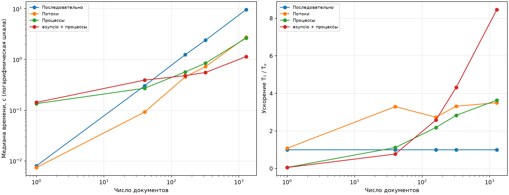
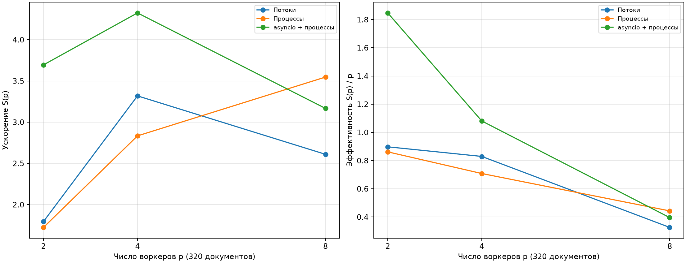

# Практическое занятие 6

## Параллелизм конкурентность и ограничения GIL

**Дисциплина:** Оптимизация программного кода

**Вариант:** 4

**Дата:** 4 ноября 2026 года

## 1. Цель и состав решения

Сравнить последовательную обработку документов, потоки, процессы и гибрид asyncio с процессами.

Обработка одного документа включает ожидание 5 мс, детерминированную генерацию текста длиной 800–1600 символов и расчёт признаков. В вычислении `score` для каждого символа выполняются 40 дополнительных арифметических итераций. Единицы работы независимы: генератор `Random(doc_id)` локален. Документы можно обрабатывать в любом порядке, но результаты собираются в порядке входных ID; повторные ID не удаляются.

## 2. Среда и методика

- ОС: `Windows-11-10.0.26200-SP0`.
- CPU: 13th Gen Intel(R) Core(TM) i9-13900H; 14 физических ядер, 20 логических процессоров.
- ОЗУ: 16890716160 байт, 15.73 ГиБ.
- Python: `3.12.14 (main, Aug 25 2026, 14:01:42) [MSC v.1944 64 bit (AMD64)]`; обычная сборка CPython с GIL.
- Запуск: отдельный процесс Python из PowerShell, без профилировщика; для процессов явно выбран Windows `spawn`.

Для каждой конфигурации первый полный запуск отброшен; далее выполнено 5 измерений `perf_counter`. Приведены медиана и min–max. Перед каждым вызовом создаётся новый пул, а его завершение входит во время. Прогрев не означает повторное использование пула. Поэтому измеряется стоимость полной самостоятельной операции, включая создание процессов, передачу данных и завершение воркеров.

Входной список ID создаётся вне измеряемого интервала. Генерация текста внутри неизменяемых `load_document` и `load_document_async` включена во время: это часть заданной единицы работы. Для диагностического CPU-эксперимента готовые тексты, напротив, создаются заранее и не входят во время. Все результаты каждого повтора автоматически сверяются с эталоном.

Использованы 40, 160 и 320 документов, соответствующие `SCALES=[1,4,8]`, а также дополнительные крайние размеры: 1 документ и 1280 документов (`scale=32`, в 4 раза больше исходного максимума). Основное сравнение использует 4 воркера; на 320 документах дополнительно измерены 2 и 8. Измерения проводились последовательно, без параллельного запуска других тестов. Пользовательские приложения принудительно не закрывались; влияние фоновой нагрузки, прогрева CPU и частот не исключено. Настройка ОС предоставляет 20 логических процессоров; отдельный лимит виртуальной машины не устанавливался и аппаратная эффективность ядер отдельно не измерялась.

## 3. Анализ нагрузки и прогноз до эксперимента

Компоненты эталона измерялись отдельно до сравнения моделей: ожидание `sleep`, `_make_text`, `text_features` и итоговое сложение. Использованы тот же набор ID и те же единицы работы; для каждого размера выполнен прогрев и 5 повторений. Доли — отношение медиан компонентов к их сумме, а не точное профилирование общего вызова: дополнительные отметки времени и изменение расположения редукции вносят небольшой эффект.

| Документов | Ожидание, % | Генерация, % | Признаки, % | Редукция, % |
|---:|---:|---:|---:|---:|
| 1 | 74.2609 | 3.2908 | 22.4442 | 0.0041 |
| 40 | 68.9413 | 3.6346 | 27.4235 | 0.0006 |
| 160 | 63.6932 | 4.7818 | 31.5245 | 0.0004 |
| 320 | 67.3064 | 4.5226 | 28.1708 | 0.0003 |
| 1280 | 69.0375 | 4.0067 | 26.9554 | 0.0003 |

| Функция | Характер нагрузки | Доля времени | Возможность параллельного выполнения |
|---|---|---|---|
| `make_workload` | Создание списка ID | Вне измеряемого участка | Не является узким местом |
| `load_document` | Смешанная: ожидание и генерация текста | Сумма первых двух компонент таблицы | Независима для каждого ID; потоки перекрывают ожидание |
| `_make_text` | CPU, генератор и сборка строки | Колонка «Генерация» | В процессах; потоки ограничены GIL |
| `text_features` | CPU, циклы Python | Колонка «Признаки» | В процессах; в потоке цикл событий выполнять нельзя |
| `load_document_async` | Кооперативное ожидание, затем небольшая CPU-часть генерации | Асинхронный аналог загрузки; отдельно доля не измерялась | Ожидания перекрываются в asyncio |
| Агрегация | Последовательное сложение результатов | Колонка «Редукция» | Сохранён порядок входных ID |

Тексты и результаты не используют изменяемое общее состояние. Замены арифметики признаков, кэширования документов или уменьшения числа итераций нет: все модели выполняют одинаковую полезную работу.

### Гранулярность и передача данных

На первых 40 документах средняя длина — 1213.4 символа. При локальном тесте `pickle` средний сериализованный текст занимал 1231.4 байта, ID-пример — 5 байт, скалярный score — 21 байт. Это полезные данные без заголовков очередей, служебных объектов Future и протокола пула.

В обычном процессном варианте передаётся ID; текст создаётся в дочернем процессе и обратно передаётся только score. `chunksize=4` объединяет мелкие задания и уменьшает число сообщений, сохраняя достаточное число блоков на больших наборах. В asyncio загрузка выполняется в основном процессе, поэтому в вычислительный пул передаётся целая строка. Семафор ограничивает одновременно активные цепочки величиной `2 * workers`; весь список задач и результатов всё равно занимает `O(N)` памяти.

### Оценка по закону Амдала

`S(p) ≤ 1 / (f + (1-f)/p)`, `E(p)=S(p)/p`. Для процессов в оптимистическом прогнозе `f` равна доле редукции; запуск пула, обмен и дисбаланс не учтены, поэтому ожидаемый предел близок к 2, 4 и 8. Для потоков условно отнесены к `f` генерация и вычисления, которые ограничены GIL. Такая двухфазная модель не учитывает перекрытие CPU одной задачи с ожиданием другой и **не является строгой верхней границей для данного конвейера**. Дополнительная оценка идеальной пропускной способности потоков — `min(p, 1 / CPU_share)`, без накладных расходов. Для одного задания также действует ограничение числом независимых заданий: дополнительные воркеры работу не дробят.

| Документов | Ожидание | CPU и редукция | A_threads(2) | A_threads(4) | A_threads(8) | A_proc(2) | A_proc(4) | A_proc(8) |
|---:|---:|---:|---:|---:|---:|---:|---:|---:|
| 1 | 74.3% | 25.7% | 1.59 | 2.26 | 2.86 | 2.00 | 4.00 | 8.00 |
| 40 | 68.9% | 31.1% | 1.53 | 2.07 | 2.52 | 2.00 | 4.00 | 8.00 |
| 160 | 63.7% | 36.3% | 1.47 | 1.91 | 2.26 | 2.00 | 4.00 | 8.00 |
| 320 | 67.3% | 32.7% | 1.51 | 2.02 | 2.43 | 2.00 | 4.00 | 8.00 |
| 1280 | 69.0% | 31.0% | 1.53 | 2.07 | 2.53 | 2.00 | 4.00 | 8.00 |

Прогноз зафиксирован в [forecast.md](forecast.md) до запуска основного эксперимента: на малом наборе запуск процессов не окупится, потоки будут полезны на средних размерах, а на большом наборе процессы смогут распараллелить CPU-часть. Между обычными процессами и asyncio-гибридом победитель заранее не выбран.

## 4. Реализации

- `run_sequential(doc_ids)` — неизменённый эталон.
- `run_threads(doc_ids, workers=4)` — `ThreadPoolExecutor`, целый документ на задание. Результаты `map` выдаются по входному порядку.
- `run_processes(doc_ids, workers=4)` — `ProcessPoolExecutor`, обработчик на верхнем уровне модуля, `spawn`, блоки по 4 документа.
- `run_asyncio(doc_ids, workers=4)` — синхронная обёртка с теми же входом и выходом. Внутренний `run_async` использует `await load_document_async`, а `text_features` передаётся через `loop.run_in_executor` в процессный пул. `gather` сохраняет порядок результатов.

Все функции возвращают `(total_score, len(doc_ids))`; пустой список даёт `(0.0,0)`. Асинхронную `run_async` можно ожидать из уже запущенного цикла событий; обёртка `run_asyncio` предназначена для обычного синхронного вызова.

В предоставленной async-загрузке `_make_text` вызывается после ожидания внутри самой функции. Этот короткий CPU-участок остаётся в цикле событий, поскольку изменение единицы работы запрещено; дорогостоящая `text_features` вынесена из него. Ни `time.sleep`, ни расчёт признаков в асинхронной цепочке напрямую не выполняются.

Четыре воркера выбраны как основной умеренный размер пула, существенно меньший 20 логических процессоров. Потоки выбираются по отношению времени ожидания к CPU-части, процессы — по доступным ядрам, стоимости запуска и гранулярности заданий. Равное число воркеров в основной таблице позволяет сопоставить модели. Лучшее измеренное число на 320 документах обсуждается ниже; универсальный оптимум для всех размеров не заявляется.

## 5. Основные измерения

`S = T_seq / T_model`. Для потоков и процессов `E=S/p`. Для asyncio-гибрида `p` — число вычислительных процессов: дополнительный основной процесс обслуживает загрузку и цикл событий, поэтому E является условной метрикой, а не полной аппаратной эффективностью. Это также не CPU utilization.

| Документов | Модель | p | Медиана, с | min–max, с | S | E |
|---:|---|---:|---:|---:|---:|---:|
| 1 | Последовательно | 1 | 0.0080 | 0.0073–0.0084 | 1.00 | 1.00 |
| 1 | Потоки | 4 | 0.0075 | 0.0071–0.0083 | 1.08 | 0.27 |
| 1 | Процессы | 4 | 0.1354 | 0.1278–0.1671 | 0.06 | 0.01 |
| 1 | asyncio + процессы | 4 | 0.1430 | 0.1308–0.1858 | 0.06 | 0.01 |
| 40 | Последовательно | 1 | 0.3047 | 0.2866–0.3244 | 1.00 | 1.00 |
| 40 | Потоки | 4 | 0.0924 | 0.0905–0.1078 | 3.30 | 0.82 |
| 40 | Процессы | 4 | 0.2724 | 0.2690–0.3254 | 1.12 | 0.28 |
| 40 | asyncio + процессы | 4 | 0.3938 | 0.3418–0.4968 | 0.77 | 0.19 |
| 160 | Последовательно | 1 | 1.2466 | 1.1836–1.2955 | 1.00 | 1.00 |
| 160 | Потоки | 4 | 0.4562 | 0.3781–0.5207 | 2.73 | 0.68 |
| 160 | Процессы | 4 | 0.5703 | 0.5137–0.5717 | 2.19 | 0.55 |
| 160 | asyncio + процессы | 4 | 0.4821 | 0.4103–0.5358 | 2.59 | 0.65 |
| 320 | Последовательно | 1 | 2.4096 | 2.3693–2.4865 | 1.00 | 1.00 |
| 320 | Потоки | 4 | 0.7261 | 0.7136–0.8661 | 3.32 | 0.83 |
| 320 | Процессы | 4 | 0.8503 | 0.8333–0.8622 | 2.83 | 0.71 |
| 320 | asyncio + процессы | 4 | 0.5572 | 0.5494–0.5825 | 4.32 | 1.08 |
| 1280 | Последовательно | 1 | 9.6900 | 9.4957–10.2249 | 1.00 | 1.00 |
| 1280 | Потоки | 4 | 2.7646 | 2.6306–3.0257 | 3.50 | 0.88 |
| 1280 | Процессы | 4 | 2.6607 | 2.6232–2.7442 | 3.64 | 0.91 |
| 1280 | asyncio + процессы | 4 | 1.1446 | 1.1019–1.3943 | 8.47 | 2.12 |



### Выбор числа воркеров на 320 документах

| Модель | p | Медиана, с | min–max, с | S | E |
|---|---:|---:|---:|---:|---:|
| asyncio + процессы | 2 | 0.6522 | 0.5895–0.8825 | 3.69 | 1.85 |
| asyncio + процессы | 4 | 0.5572 | 0.5494–0.5825 | 4.32 | 1.08 |
| asyncio + процессы | 8 | 0.7609 | 0.7203–0.8807 | 3.17 | 0.40 |
| Процессы | 2 | 1.3976 | 1.3422–1.4988 | 1.72 | 0.86 |
| Процессы | 4 | 0.8503 | 0.8333–0.8622 | 2.83 | 0.71 |
| Процессы | 8 | 0.6794 | 0.6432–0.7833 | 3.55 | 0.44 |
| Потоки | 2 | 1.3421 | 1.1868–1.3588 | 1.80 | 0.90 |
| Потоки | 4 | 0.7261 | 0.7136–0.8661 | 3.32 | 0.83 |
| Потоки | 8 | 0.9231 | 0.7947–1.0425 | 2.61 | 0.33 |



### Отдельные CPU- и I/O-эксперименты

Для 160 готовых текстов измерена только неизменённая `text_features`. Отдельно выполнены 160 ожиданий по 5 мс без генерации и вычислений. Полный жизненный цикл пула включён; результаты диагностик нельзя складывать для восстановления смешанного сценария.

| Нагрузка | Модель | p | Медиана, с | min–max, с | S | E |
|---|---|---:|---:|---:|---:|---:|
| cpu_only | Последовательно | 1 | 0.3572 | 0.3091–0.4357 | 1.00 | 1.00 |
| cpu_only | Потоки | 4 | 0.3867 | 0.3384–0.4023 | 0.92 | 0.23 |
| cpu_only | Процессы | 4 | 0.3715 | 0.3444–0.3826 | 0.96 | 0.24 |
| io_only | Последовательно | 1 | 0.8622 | 0.8596–0.8687 | 1.00 | 1.00 |
| io_only | Потоки | 4 | 0.2176 | 0.2154–0.2195 | 3.96 | 0.99 |
| io_only | Процессы | 4 | 0.4805 | 0.4388–0.5434 | 1.79 | 0.45 |

## 6. Корректность и устойчивость

Встроенный набор `unittest`: **6 тестов, все пройдены**. Проверены пустой ввод; одиночный документ; перемешанные, повторные и отрицательные ID; полный набор из 40 ID; совпадение синхронной и асинхронной загрузки; недопустимое число воркеров; передача исключения вызывающему коду; повторное создание и закрытие пулов. Для сумм в тестах применяется `math.isclose(rel_tol=1e-12, abs_tol=1e-9)`, для количества — точное равенство. Каждый измеренный повтор дополнительно проверен с `rel_tol=1e-12, abs_tol=1e-8`.

Суммирование происходит в исходном порядке, но параллельные реализации используют `sum`, а эталон — `+=`; возможна небольшая разница округления float. Порядок не подменяет проверку с допуском. Общая изменяемая сумма потокам не передаётся: редукция выполняется в вызывающем процессе. Локальные генераторы текста не делят глобальное состояние `random`.

Пулы оформлены через `with`, а точка запуска защищена `if __name__ == '__main__'`. При ошибке asyncio отменяет ожидающие задачи и получает их завершение. Уже запущенное вычисление в дочернем процессе отменой Future принудительно не прерывается; выход из контекста пула ожидает выполняющуюся работу. Тайм-ауты и повторные попытки не добавлены, поскольку в заданном локальном симуляторе нет внешнего сервиса с отказами.

Первый запуск тестов внутри ограниченной песочницы завис при создании Windows asyncio. Этот запуск остановлен; тесты и основной эксперимент успешно выполнены вне песочницы. Это ограничение среды запуска не использовано как результат производительности. Отдельное измерение долей нагрузки выполнялось без процессов; различие условий и фоновые факторы учтены при сравнении прогноза с фактом.

## 7. Анализ результатов и выбор модели

На 320 документах среди измеренных конфигураций быстрее всего **asyncio + процессы с p=4**: 0.5572 с, ускорение 4.32×. На 1280 документах при p=4 быстрее всего **asyncio + процессы**: 1.1446 с, ускорение 8.47×. Число воркеров 2 и 8 на 1280 документах отдельно не проверялось.

Прогноз о существенных расходах процессов на малых заданиях подтверждается. На одном документе различия последовательной версии и потоков сравнимы с разбросом; создавать процессный пул для такой работы нецелесообразно. На средних размерах потоки дают заметный выигрыш благодаря перекрытию ожиданий. Гибрид позволяет перекрывать ожидания и использовать несколько ядер для признаков, но добавляет передачу строк и задачи цикла событий.

Диагностика CPU-only показывает, что добавление потоков не обеспечивает многократного ускорения циклов Python: при GIL байткод выполняется одним потоком одновременно. В I/O-only ожидание освобождает исполнение, поэтому потоки его перекрывают. Процессы обходят общий GIL, но для мелких заданий стоимость spawn, импорта модулей, сериализации, IPC, диспетчеризации и завершения может поглотить выигрыш. Эти наблюдения относятся к текущей обычной сборке CPython; их нельзя автоматически переносить на сборку без GIL или библиотеки, освобождающие GIL.

Условный прогноз Амдала для потоков может оказаться ниже измеренного ускорения: он складывает CPU и ожидания как неперекрывающиеся фазы, тогда как в программе они перекрываются между документами. Оптимистический прогноз процессов около p, наоборот, завышает практический результат из-за неучтённых расходов. Доля редукции слишком мала, чтобы объяснить расходы запуска пула; замер этих расходов нельзя заменить подстановкой этой доли в формулу. Для небольшого N действуют также ограничение числа задач и дисбаланс блоков.

Для гибрида на 1280 документах S≈8.47 при четырёх вычислительных процессах, поэтому условная E≈2.12. Это не сверхлинейное ускорение чистых вычислений: исходное время включает длинную последовательность ожиданий, а гибрид перекрывает их в основном процессе независимо от четырёх CPU-воркеров. Ограничение S≤p для одинакового набора из p вычислительных исполнителей и приведённая оценка Амдала для обычных процессов к такому смешанному гибриду напрямую не применяются.

На 320 документах увеличение числа потоков с 4 до 8 ухудшило медиану с 0.7261 до 0.9231 с; для гибрида также лучше 4, чем 8 процессов (0.5572 против 0.7609 с). У обычных процессов 8 воркеров быстрее 4, но эффективность ниже. Подбор p нельзя заменить правилом «использовать все логические ядра».

Увеличение p не гарантирует пропорционального ускорения. Эффективность снижается из-за постоянных расходов, конкуренции за ядра, ограничений GIL для потоков, сериализации и последовательного управления. Разброс и изменяющиеся условия также влияют на сравнение: на 160 документах диапазоны потоков и гибрида перекрываются, поэтому небольшую разницу медиан нельзя трактовать как устойчивое преимущество на любом запуске.

Практический выбор зависит от размера: для одного дешёвого задания — последовательный вызов; для умеренной смешанной нагрузки — потоки как простой вариант без передачи текстов между процессами; для крупного потока документов — измеренный выигрыш процессных или гибридных конфигураций. Значение по умолчанию в демонстрационной функции — `threads, workers=4`; это простой консервативный выбор, а не обещание оптимума на любой нагрузке. При повторной обработке больших партий стоит дополнительно измерить долгоживущий пул: в настоящей работе пулы каждый раз новые. При преобладании реального асинхронного I/O пригоден asyncio, при тяжёлых чистых вычислениях — процессы. Если ожидание исчезнет или стоимость признаков возрастёт, выбор необходимо измерить заново.

## 8. Воспроизведение

Расчётные реализации и измеритель используют только стандартную библиотеку Python 3.9+. Из папки практики:

```powershell
python variant_4_optimized.py --test
python variant_4_optimized.py --model sequential
python variant_4_optimized.py --model threads --workers 4
python variant_4_optimized.py --model processes --workers 4
python variant_4_optimized.py --model asyncio --workers 4
python benchmark.py --stage analyze
# После анализа зафиксировать прогноз; сохранённый прогноз находится в forecast.md.
python benchmark.py --stage benchmark
```

Программа демонстрации использует исходные `SCALES`; дополнительные размеры находятся в `benchmark.py`. Измерения полностью перезаписывают JSON соответствующего этапа. `hardware.json` хранит фактическую среду данного запуска: при переносе на другой компьютер его нужно обновить. Для повторного построения изображений и отчёта требуется Matplotlib:

```powershell
python build_report.py
```

Сырые данные: [analysis_results.json](analysis_results.json), [benchmark_results.json](benchmark_results.json), [hardware.json](hardware.json). Полный код всех моделей и тестов находится в отдельном Python-файле; исходная программа сохранена рядом. Изображения строятся из сохранённых чисел, а не вручную заданных измерений.

## 9. Документация

Поведение пулов, сериализации процессных задач и `chunksize` сверено с [документацией concurrent.futures для Python 3.12](https://docs.python.org/3.12/library/concurrent.futures.html). Передача вычислений из цикла событий опирается на [документацию run_in_executor](https://docs.python.org/3.12/library/asyncio-eventloop.html#executing-code-in-thread-or-process-pools). Вывод о предпочтительной конфигурации сделан по локальным измерениям, а не по документации.
